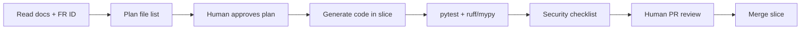

# AI Context — JPetStore Python Modernization

This document is the **primary context bundle** for AI-assisted implementation. Load it with analysis docs and `API_SPECIFICATION.md` before generating code.

---

## 1. Project identity

| Field | Value |
|-------|-------|
| Name | JPetStore Python (modernization) |
| Legacy reference | `jpetstore-6/` (read-only; do not modify) |
| Analysis | `docs/EXISTING_*.md`, `FUNCTIONAL_REQUIREMENTS.md`, `BUSINESS_WORKFLOWS.md`, `DATA_MODEL.md`, `TECHNICAL_REQUIREMENTS.md`, `ANALYSIS_GAPS.md` |
| Target design | `docs/TARGET_ARCHITECTURE.md`, `docs/API_SPECIFICATION.md`, `docs/ADR.md` |
| Guardrails | `docs/AI_GUARDRAILS.md` |

---

## 2. Non-negotiable constraints

1. **No new business features** — only FR IDs in `FUNCTIONAL_REQUIREMENTS.md`.
2. **No Kafka, Kubernetes, Redis** in baseline Compose.
3. **Four services + Gateway** — do not collapse into monolith without ADR.
4. **Order atomicity** — one SQLAlchemy transaction in Order Service matching ADR-003 and TR-4.1 step order (with ADR-008 lock).
5. **Distinguish parity vs improvement** — see §4 below.

---

## 3. Repository map (when implemented)

```
haiintel/
  docker-compose.yml
  docker-compose.test.yml
  pyproject.toml                 # workspace / tool config
  packages/
    jpetstore_common/            # settings, logging, jwt helpers, httpx clients
  services/
    api_gateway/
    catalog_service/
    account_service/
    order_service/
  db/
    mysql/init/                  # 01_catalog.sql, 02_account.sql, 03_order.sql, 99_seed.sql
  tests/
    e2e/
  docs/                          # this folder
  jpetstore-6/                   # legacy reference only
```

---

## 4. Parity vs intentional improvement

| Area | Implement as | Reference |
|------|--------------|-----------|
| Workflows | Same user-visible outcomes | `BUSINESS_WORKFLOWS.md` |
| Search empty keyword | 400 + exact message | FR-1.5 |
| Register without login | 201, no token | FR-3.6 |
| Order insert side effects | Decrement inventory, clear cart, status `P` | FR-4.5–4.6 |
| Negative inventory / no submit stock check | Allow | ADR-009, TR-6.1–6.2 |
| Duplicate search hits | Allow | TR-6.5 |
| `orderstatus.linenum` | Set to `order_id` | TR-6.4 |
| Passwords | bcrypt | ADR-005 (**improvement**) |
| Auth mechanism | JWT | ADR-004 (**improvement**) |
| Duplicate POST orders | Idempotency-Key | ADR-007 (**improvement**) |
| Sequence race | `FOR UPDATE` | ADR-008 (**improvement**) |

When AI is unsure, **default to parity** unless row is marked improvement.

---

## 5. Code generation anchors (legacy → Python)

| Legacy | Python location |
|--------|-----------------|
| `CatalogService` | `catalog_service/services/catalog.py` |
| `AccountService` | `account_service/services/account.py` |
| `OrderService.insertOrder` | `order_service/services/order.py` → `place_order()` |
| `Cart` / `CartController` | `order_service/services/cart.py` |
| `OrderController.newOrder` merge logic | `order_service/services/checkout.py` |
| MyBatis `*Mapper.xml` | SQLAlchemy models + repository modules per service |
| `applicationContext.xml` tx | `@asynccontextmanager` or FastAPI dependency with `session.begin()` |

**SQL parity examples:**

- Inventory: `UPDATE inventory SET qty = qty - :increment WHERE itemid = :itemId`
- Search: `LOWER(name) LIKE :kw` per whitespace token, concatenate results
- Account load: join account + profile + signon + bannerdata (banner in catalog schema — join via HTTP or duplicate banner read in Account seed)

**Banner data:** Stored in catalog schema; Account Service calls Catalog internal API or embeds banner name in profile response via Gateway aggregation—implementer follows `AccountMapper.xml` field list.

---

## 6. Environment variables (standard names)

| Variable | Used by |
|----------|---------|
| `MYSQL_HOST`, `MYSQL_PORT`, `MYSQL_USER`, `MYSQL_PASSWORD` | All services |
| `CATALOG_DATABASE_URL` | Catalog |
| `ACCOUNT_DATABASE_URL` | Account |
| `ORDER_DATABASE_URL` | Order |
| `JWT_SECRET`, `JWT_ALGORITHM`, `JWT_EXPIRE_MINUTES` | Account, Gateway |
| `CATALOG_SERVICE_URL`, `ACCOUNT_SERVICE_URL`, `ORDER_SERVICE_URL` | Gateway, cross-calls |
| `LOG_LEVEL` | All |

---

## 7. AI-assisted implementation workflow



**Slice order (mandatory):**  
1) `db/` + Compose MySQL  
2) `jpetstore_common`  
3) Catalog → Account → Order → Gateway  
4) e2e tests last  

One slice = one PR-sized unit (see TARGET_ARCHITECTURE §12).

---

## 8. Repository-grounded generation rules

1. **Cite FR/TR/ADR** in PR description when adding behavior.
2. **Copy seed data** from `jpetstore-6/src/main/resources/database/jpetstore-hsqldb-dataload.sql` adapted to MySQL syntax—do not invent products/users.
3. **Mapper XML** is authoritative for column names and SQL semantics (`jpetstore-6/src/main/resources/org/mybatis/jpetstore/mapper/`).
4. **Controller merge logic** for checkout: `OrderController.java` lines 159–206 for null-safe field merge.
5. If legacy and target doc conflict, **legacy source wins** for parity; file ADR for intentional deviation.

---

## 9. Human approval requirements

| Change type | Approval |
|-------------|----------|
| New REST endpoint or field | Human + update `API_SPECIFICATION.md` |
| New table/column | Human + update `DATA_MODEL` / TARGET §3 |
| Breaking parity | Human + new ADR entry |
| Dependency addition | Human if not in pyproject baseline |
| AI-generated auth/crypto code | Human security review (see AI_GUARDRAILS) |

---

## 10. Automated validation (CI-local)

| Gate | Command / tool |
|------|----------------|
| Unit + integration tests | `pytest` |
| Lint | `ruff check` |
| Types | `mypy` (strict on `services/`) |
| API schema | `pytest tests/e2e/test_openapi.py` |
| Compose smoke | `docker compose up -d && pytest tests/e2e` |

AI must not mark task complete without passing pytest for touched service.

---

## 11. Acceptance criteria for AI-generated code

- [ ] Matches an FR ID or ADR decision explicitly  
- [ ] No scope outside four services + gateway + common + db  
- [ ] Order write path uses single transaction  
- [ ] No secrets in repo; `.env.example` only  
- [ ] OpenAPI matches `API_SPECIFICATION.md` for changed routes  
- [ ] Tests added for new behavior (happy + one failure path)  
- [ ] Structured log on request completion  
- [ ] `/health/live` and `/health/ready` present  

---

## 12. Prompt template for agents

```
Task: [FR-x.y or endpoint name]
Read: docs/FUNCTIONAL_REQUIREMENTS.md, docs/API_SPECIFICATION.md, docs/ADR.md
Legacy: jpetstore-6/[relevant Java files]
Constraints: docs/AI_GUARDRAILS.md
Deliver: [files] + pytest
Parity: [yes/no — cite TR/ADR]
```
