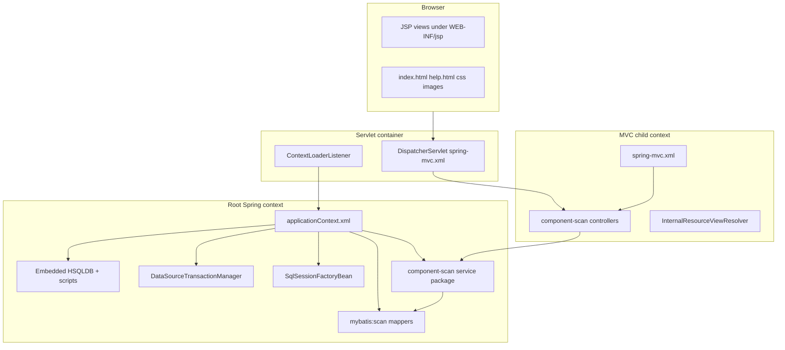

# JPetStore 6 — Existing Architecture

**Analysis source:** `jpetstore-6/` (MyBatis JPetStore Demo 6, version `6.4.1-SNAPSHOT` per `pom.xml`).  
**Scope:** Read-only architecture inventory for Python modernization. Verified facts cite paths; assumptions are labeled.

---

## 1. Technology stack (from `pom.xml`)

| Concern | Version / artifact | Evidence |
|--------|---------------------|----------|
| Java | 11 (`java.version`, `java.release.version`) | `jpetstore-6/pom.xml` L60–63 |
| Maven parent | `org.mybatis:mybatis-parent:53` | L23–27 |
| Packaging | WAR (`jpetstore`) | L33, L255 |
| MyBatis | 3.6.0 | L105–108 |
| MyBatis-Spring | 2.1.2 | L110–113 |
| Spring Framework | 5.3.39 (`spring-context`, `spring-jdbc`, `spring-web`, `spring-webmvc`) | L76, L116–141 |
| Servlet API | Jakarta Servlet 4.0.4, JSP API 2.3.6 (provided) | L154–165 |
| JSTL | taglibs-standard 1.2.5 | L143–151 |
| Database (embedded) | HSQLDB 2.7.4 (jdk8 classifier) | L73, L184–188 |
| Logging | SLF4J 2.0.20 + slf4j-simple; commons-logging 1.4.0 | L72–75, L167–181 |
| Tests | JUnit Jupiter 6.1.3, Mockito 5.24.0, AssertJ 3.27.7, Spring Test, Selenide 7.19.1, Selenium BOM 4.52.0 / htmlunit3-driver 4.51.0 | L191–251 |
| IT container (default profile) | Tomcat 9.0.120 via Cargo Maven plugin 1.10.30 | L79, L330–338, L292–310 |

**Note:** Application Java sources import `javax.servlet.*` (e.g. `AccountController.java`) while `pom.xml` declares Jakarta servlet APIs—runtime depends on the servlet container’s classpath bridging (typical for EE8 deployments).

---

## 2. Deployment and Spring context structure

| File | Role |
|------|------|
| `src/main/webapp/WEB-INF/web.xml` | `ContextLoaderListener`; `DispatcherServlet` mapped to `/`; welcome file `index.html` |
| `src/main/webapp/WEB-INF/applicationContext.xml` | Embedded DB, transaction manager, MyBatis factory, mapper scan, **service** component scan |
| `src/main/webapp/WEB-INF/spring-mvc.xml` | MVC annotation-driven, **controller** scan, JSP view resolver prefix `/WEB-INF/jsp/` |
| `src/main/java/.../StaxFactoryInitializationListener.java` | `@WebListener` sets StAX system properties for some app servers (Payara/Java 17 note in comment) |

Database bootstrap (verified): `jdbc:embedded-database` runs `classpath:database/jpetstore-hsqldb-schema.sql` then `jpetstore-hsqldb-dataload.sql` (`applicationContext.xml` L31–34).

---

## 3. Source package layout

Base package: `org.mybatis.jpetstore`

| Package | Classes | Responsibility |
|---------|---------|----------------|
| `domain` | `Account`, `Cart`, `CartItem`, `Category`, `Item`, `LineItem`, `Order`, `Product`, `Sequence` | Serializable domain models; cart/order logic in `Cart`, `Order` |
| `mapper` | `AccountMapper`, `CategoryMapper`, `ItemMapper`, `LineItemMapper`, `OrderMapper`, `ProductMapper`, `SequenceMapper` | MyBatis mapper interfaces |
| `service` | `AccountService`, `CatalogService`, `OrderService` | Business orchestration; `@Transactional` on write paths |
| `web.controllers` | `RootController`, `AccountController`, `CartController`, `CatalogController`, `OrderController` | Spring MVC; session state (`cart`, `accountBean`, `order`) |
| `web.configuration` | `StaxFactoryInitializationListener` | Servlet container workaround |

**Presentation:** JSP under `src/main/webapp/WEB-INF/jsp/{account,cart,catalog,order,common}/`. Static assets under `src/main/webapp/`.

**Not mapped in Java:** DB tables `supplier`, `bannerdata`, and standalone `signon`/`profile` are accessed only via SQL in `AccountMapper.xml` (no `Supplier` entity or service).

---

## 4. Layer interactions

1. **Controllers** call **services** (Autowired). Cart operations mostly use `CatalogService` + in-session `Cart` (no `CartService`).
2. **Services** call **MyBatis mappers**; SQL in `src/main/resources/org/mybatis/jpetstore/mapper/*.xml`.
3. **Transactions:** Spring `DataSourceTransactionManager` + `@Transactional` on `OrderService.insertOrder`, `OrderService.getOrder`, `AccountService.insertAccount`, `AccountService.updateAccount` (`applicationContext.xml` L36–45; service classes).

---

## 5. Session and authentication model

- **Authentication:** Form POST `/account/signon` → `AccountService.getAccount(username, password)` → session attribute `accountBean` (`AccountController.AccountSession` with `authenticated` flag). Password cleared from session copy after sign-on (L96).
- **Authorization:** Ad hoc checks in controllers (e.g. `OrderController.listOrders`, `OrderController.viewOrder` compares `order.getUsername()` to signed-in user). No Spring Security filter chain.
- **Cart:** HttpSession attribute `cart` (`CartController.getCart`).
- **Checkout:** HttpSession attribute `order` built in `OrderController.newOrderForm` via `Order.initOrder(account, cart)`.

---

## 6. MyBatis configuration

- Type aliases: entire `org.mybatis.jpetstore.domain` package (`applicationContext.xml` L50).
- Every mapper XML declares `<cache />` (second-level cache enabled per namespace)—see performance notes in `TECHNICAL_REQUIREMENTS.md`.
- Mapper XML location convention: `classpath:org/mybatis/jpetstore/mapper/{Name}Mapper.xml`.

---

## 7. Automated test architecture

| Layer | Location | Style |
|-------|----------|--------|
| Domain | `domain/CartTest.java`, `domain/OrderTest.java` | Unit |
| Mappers | `mapper/*MapperTest.java` + `MapperTestContext.java` | Spring + embedded DB |
| Services | `service/*ServiceTest.java` | Mockito unit tests |
| Controllers | `web/controllers/*ControllerTest.java` | MockMvc / mocks |
| E2E | `ScreenTransitionIT.java` | Selenide vs `http://127.0.0.1:8080/jpetstore` (Cargo Tomcat in Failsafe) |

---

## 8. Related artifacts not used at runtime

- `src/main/resources/database/jpetstore-hsqldb-data.sql` — alternate schema script (uppercase identifiers); **not** referenced by `applicationContext.xml`. Treat as legacy/reference unless explicitly wired elsewhere.

---

## 9. Assumptions (not verified by running the app in this analysis)

- Default Cargo profile serves the WAR at context path `/jpetstore` (inferred from `ScreenTransitionIT` `baseUrl` and image paths in seed data).
- Production deployments may replace embedded HSQLDB with an external datasource (not configured in this repo’s main `applicationContext.xml`).
