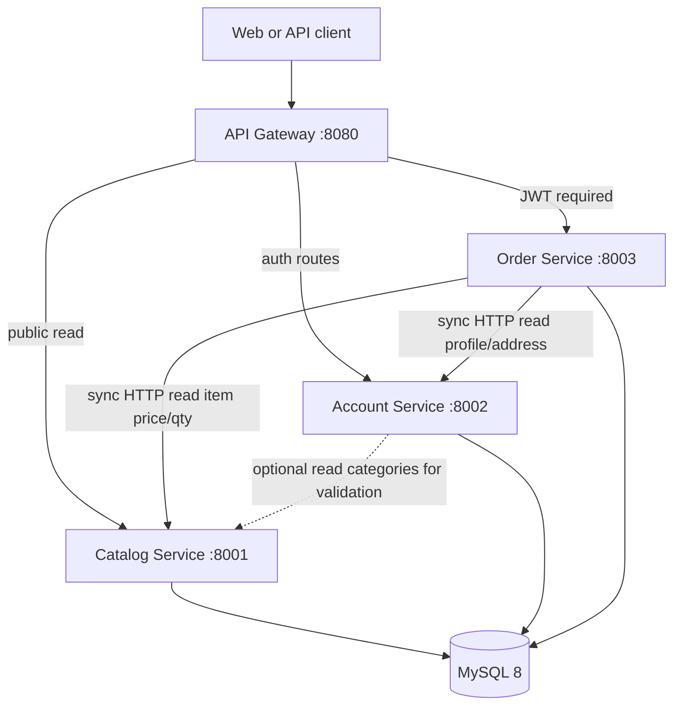

# JPetStore Python — Target Architecture

**Status:** Design for assessment implementation  
**Stack:** Python 3.12+, FastAPI, SQLAlchemy 2, Pydantic, MySQL 8, Docker Compose, JWT, pytest  
**Source of truth (legacy):** `docs/EXISTING_ARCHITECTURE.md`, `FUNCTIONAL_REQUIREMENTS.md`, `BUSINESS_WORKFLOWS.md`, `DATA_MODEL.md`, `TECHNICAL_REQUIREMENTS.md`

---

## 1. Goals and scope

| Goal | Approach |
|------|----------|
| Preserve customer workflows | Map JSP/session flows to REST + optional BFF at gateway (see §8) |
| Preserve order + inventory atomicity | Single MySQL transaction in **Order Service** only (TR-4.1 parity) |
| Modernize safely | JWT + password hashing documented as **intentional improvements** (not parity) |
| Stay lean | Docker Compose only; no Kafka, Kubernetes, or Redis in baseline |

**Out of scope:** Admin catalog, payment gateways, order status workflows after `P`, new business features.

---

## 2. Logical architecture



### Service responsibilities

| Service | Owns | Does not own |
|---------|------|----------------|
| **API Gateway** | Route prefix → service; JWT validation on protected routes; CORS; request ID; optional static UI proxy | Business logic; database |
| **Catalog Service** | Categories, products, items (SKU master), suppliers (read), bannerdata (read); product search | Cart, orders, inventory writes, credentials |
| **Account Service** | Registration; login; JWT issuance; profile; account CRUD; password verify/hash | Orders, cart, catalog mutations |
| **Order Service** | Cart; checkout draft; order placement; order history; **inventory** table; **sequence** (`ordernum`); line items; order status insert | Product/category master edits |

---

## 3. Database ownership (MySQL)

One MySQL 8 server, **three schemas** (logical per-service databases). No cross-schema FKs; referential integrity by `itemid` / `userid` strings at application level.

| Schema | Tables | Maps from legacy |
|--------|--------|------------------|
| `jpetstore_catalog` | `category`, `product`, `item`, `supplier`, `bannerdata` | Same names as `jpetstore-hsqldb-schema.sql` |
| `jpetstore_account` | `account`, `profile`, `signon` | Password column stores **hash** (improvement) |
| `jpetstore_order` | `inventory`, `sequence`, `orders`, `lineitem`, `orderstatus`, `cart`, `cart_line`, `checkout_draft`, `idempotency_key` | Cart/checkout new; core order tables from legacy |

**Inventory placement:** Legacy colocated inventory with items. Order Service owns `inventory` and all decrements inside TR-4.1 transaction. Catalog Service returns **cached qty** via internal API calling Order Service **or** denormalized read replica view—**baseline:** Catalog calls Order `GET /internal/inventory/{itemId}` for item detail and `is_in_stock` (sync HTTP, assessment-simple).

**Sequence:** `sequence` row `ordernum` lives in `jpetstore_order`; allocation uses `SELECT ... FOR UPDATE` in same transaction as order insert (**improvement** over legacy optimistic update; preserves monotonic IDs).

---

## 4. Workflow preservation

| Legacy flow | Target mapping |
|-------------|----------------|
| Browse catalog | `GET /api/v1/catalog/...` via Gateway → Catalog |
| Search (empty keyword error) | `400` + message parity with FR-1.5 |
| Cart session | `cart` owned by Order Service; client sends `X-Cart-Id` (guest) or JWT `sub` (authenticated) |
| Sign-on / sign-off | `POST /api/v1/auth/login` → JWT; client discards token |
| Register → catalog, no session | `POST /api/v1/auth/register` → `201`, **no** token in response (FR-3.6) |
| My List | `GET /api/v1/account/me/my-list` → Account resolves fav category, Gateway or Account calls Catalog products-by-category |
| Checkout multi-step | `checkout_draft` row + `PUT /api/v1/checkout/draft` merges fields like `OrderController.newOrder` |
| Confirm order | `POST /api/v1/orders` with body from draft; clears cart (FR-4.6) |
| List/view own orders | JWT `sub` = username; Order Service enforces ownership (FR-4.8) |

**Parity vs improvement (summary):**

| Topic | Parity | Improvement |
|-------|--------|-------------|
| Order insert steps + rollback | Same operation order in one DB tx | Row lock on `sequence` |
| Negative inventory allowed | Yes (no check at submit) | Document; optional flag later |
| Plaintext passwords | No | bcrypt |
| Session auth | No | JWT |
| Duplicate search results | Yes | No dedupe unless product asks |
| `orderstatus.linenum` = `orderid` | Yes on insert | Same SQL shape |
| Credit card stored on order | Yes (demo) | Mark sensitive in logs only |

---

## 5. Atomic order and inventory (Order Service)

Single SQLAlchemy session, **`READ COMMITTED`**, explicit transaction:

1. Validate idempotency key (if present) — return stored response if duplicate.
2. `SELECT nextid FROM sequence WHERE name='ordernum' FOR UPDATE` → assign `order_id`.
3. For each line: `UPDATE inventory SET qty = qty - :n WHERE itemid = :id` (parity: no lower bound).
4. `INSERT INTO orders ...`
5. `INSERT INTO orderstatus (orderid, linenum, ...)` with **linenum = orderid** (parity).
6. `INSERT INTO lineitem ...` for each line.
7. `UPDATE sequence SET nextid = nextid + 1`.
8. Delete cart / mark checkout complete.

**Cross-service data at confirm:** Line `unitprice` and `itemid` from cart lines (prices captured at add-to-cart from Catalog). Order Service does **not** call Catalog inside the transaction.

**Failure:** Any exception → full rollback; client receives `503` or `409` with stable error code; idempotency record not committed.

---

## 6. Inter-service communication

| From | To | When | Protocol | Failure handling |
|------|-----|------|----------|------------------|
| Gateway | All services | Every request | HTTP/JSON | 502 if upstream down; short timeout (5s) |
| Order | Catalog | Add to cart, validate item exists | `GET /internal/items/{itemId}` | 404 → cart error to client |
| Order | Catalog | Optional refresh list price | Same | Use last known price if Catalog down **only** for existing cart lines; new adds fail |
| Order | Account | Init checkout draft addresses | `GET /internal/accounts/{username}` | 401/404 block checkout start |
| Account | Catalog | Validate `favcategory` on register/update | `GET /internal/categories/{id}` | 400 invalid category |
| Gateway | Account | Login/register | Public routes | — |

**Internal routes:** `/internal/*` reachable only on Docker network; Gateway must not expose them. mTLS optional later; baseline = network isolation.

**No event bus:** All coupling is sync request/response.

---

## 7. Duplicate order requests

| Mechanism | Behavior |
|-----------|----------|
| **`Idempotency-Key` header** (required on `POST /api/v1/orders`) | Order Service stores key + username + response payload in `idempotency_key` table (unique per user). Replay within 24h returns **same** `201` body without re-running inventory. |
| **Network retry** | Safe with same key |
| **Double-click** | Same key from UI |
| **Concurrent different keys, same cart** | Second request may succeed twice (legacy had same risk); mitigation out of scope unless product requires cart lock |

---

## 8. Authentication and authorization

| Layer | Responsibility |
|-------|----------------|
| **Account Service** | `POST /auth/login` verifies bcrypt hash; returns JWT (access token, 1h TTL baseline); claims: `sub` (username), `exp`, `iat` |
| **API Gateway** | Validates JWT signature (shared `JWT_SECRET` via env); forwards `X-User-Id: {sub}` to Order/Account protected routes |
| **Order Service** | Trusts `X-User-Id` from Gateway **only** (reject if missing on protected routes); compares `order.userid` on GET order |
| **Catalog Service** | Public read endpoints; no JWT required |

**Registration:** No token (FR-3.6). **Logout:** Client-side delete token (no server session).

**Authorization matrix:**

| Action | Auth |
|--------|------|
| Catalog browse/search | Public |
| Cart (guest) | `X-Cart-Id` UUID |
| Cart merge on login | Optional improvement: attach guest cart to user |
| Checkout / orders | JWT required |

---

## 9. API Gateway routing

| Public prefix | Upstream |
|---------------|----------|
| `/api/v1/catalog/*` | Catalog Service |
| `/api/v1/auth/*`, `/api/v1/account/*` | Account Service |
| `/api/v1/cart/*`, `/api/v1/checkout/*`, `/api/v1/orders/*` | Order Service |
| `/health`, `/ready` | Gateway aggregate |
| `/docs` | Gateway OpenAPI aggregate (optional) |

Implementation: FastAPI app with `httpx` async proxy or nginx in Compose; assessment default = **FastAPI gateway** for single-language stack.

---

## 10. Health checks and observability

| Endpoint | Service | Check |
|----------|---------|-------|
| `GET /health/live` | Each | Process up → `200` |
| `GET /health/ready` | Each | MySQL ping → `200`/`503` |
| `GET /health/ready` | Gateway | All three backends ready |

**Structured logging (JSON to stdout):**

- Fields: `timestamp`, `level`, `service`, `request_id`, `method`, `path`, `status`, `duration_ms`, `user_id` (if any)
- Never log: password, JWT, full credit card (mask all but last 4 if logged at all)

**Correlation:** Gateway generates `X-Request-Id`; propagate to downstream headers.

---

## 11. Docker Compose topology

```yaml
# Conceptual — see repo docker-compose.yml when implemented
services:
  mysql:          # port 3306, init scripts per schema + seed
  catalog-service:
  account-service:
  order-service:
  api-gateway:    # depends_on: all services healthy
```

Volumes: MySQL data volume; optional mount `jpetstore-6/.../dataload.sql` adapted for MySQL.

---

## 12. Automated testing strategy

| Level | Scope | Tooling |
|-------|-------|---------|
| **Unit** | Pydantic validators, cart math, JWT helpers, idempotency logic | pytest |
| **Service integration** | Each FastAPI app + real MySQL (testcontainers or Compose profile `test`) | pytest + SQLAlchemy |
| **Contract** | OpenAPI examples vs responses | schemathesis or pytest against `/openapi.json` |
| **Cross-service** | Place order path: Catalog seed item → cart → login → confirm | pytest in `tests/e2e/` against Compose |
| **Parity fixtures** | User `j2ee`, order id from 1000, search empty keyword | From `TECHNICAL_REQUIREMENTS.md` TR-9 |

**Critical integration tests (P0):**

1. `insert_order` rolls back inventory on forced failure after decrement.
2. Idempotency-Key replay does not double-decrement.
3. User A cannot `GET` user B order.
4. Register returns no JWT.

---

## 13. Repository layout (target)

See implementation section at end of task response for full tree.

Shared Python package `jpetstore_common` (logging, settings, HTTP client) imported by all services—minimal, no shared DB models across services.

---

## 14. Related documents

| Document | Purpose |
|----------|---------|
| `API_SPECIFICATION.md` | REST contracts |
| `ADR.md` | Decision log |
| `AI_CONTEXT.md` | Context for AI-assisted coding |
| `AI_GUARDRAILS.md` | Human approval and validation gates |
