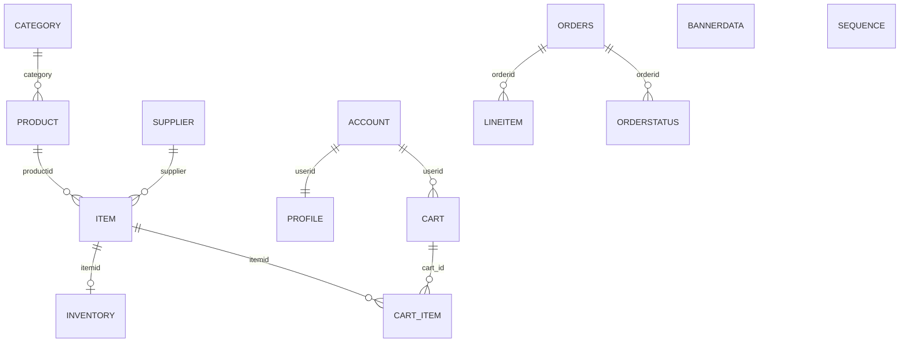

# Database Design (Phase 2)


Source: `../../docs/DATA_MODEL.md` and `jpetstore-6/.../jpetstore-hsqldb-schema.sql`.


## Development vs integration databases


| Purpose | Database | MySQL user | Charset / collation |

|---------|----------|------------|---------------------|

| Local development (MySQL 8) | `jpetstore` | `jpetstore_app` | `utf8mb4` / `utf8mb4_unicode_ci` |

| Automated MySQL integration tests | `jpetstore_test` | `jpetstore_app` | `utf8mb4` / `utf8mb4_unicode_ci` |


Configure development via **`DATABASE_URL`**. Configure integration tests via **`TEST_DATABASE_URL`** (must end with database name `jpetstore_test`). Unit tests use isolated in-memory SQLite and never connect to these databases.


## Entity relationship overview





## Tables (legacy names preserved)


| Table | PK | Notes |

|-------|-----|--------|

| `supplier` | `suppid` | |

| `category` | `catid` | |

| `product` | `productid` | FK → `category.catid`; indexes `productCat`, `productName` |

| `item` | `itemid` | FK → `product`, `supplier`; index `itemProd` |

| `inventory` | `itemid` | **No FK** to `item` (legacy parity) |

| `account` | `userid` | |

| `profile` | `userid` | **No FK** to `account` (legacy parity) |

| `signon` | `username` | `password` VARCHAR(255) for bcrypt (see ADR SEC-P2-001) |

| `bannerdata` | `favcategory` | |

| `orders` | `orderid` | Payment columns for demo parity; not PCI scope |

| `orderstatus` | `(orderid, linenum)` | |

| `lineitem` | `(orderid, linenum)` | **No FK** to `item` (legacy parity) |

| `sequence` | `name` | e.g. `ordernum` = 1000 |


### Phase 5 — cart (new)


| Table | PK | Notes |

|-------|-----|--------|

| `cart` | `cart_id` | `userid` UNIQUE → `account.userid` CASCADE; `status` (`active` / future `checked_out`); timestamps |

| `cart_item` | `cart_item_id` | FK `cart_id` CASCADE; FK `itemid` → `item`; UNIQUE `(cart_id, itemid)`; `quantity > 0` |


Migration: `alembic/versions/0003_phase5_cart.py`


### Phase 6 — checkout


| Table | PK | Notes |

|-------|-----|--------|

| `checkout_idempotency` | `id` | `UNIQUE(userid, idempotency_key)`; FK `orderid` → `orders` |

| `inventory` | `itemid` | MySQL `CHECK qty >= 0` via migration `0004` |


Migration: `alembic/versions/0004_phase6_checkout.py`


## ORM layout


| Module | Models |

|--------|--------|

| `models/catalog.py` | Category, Product, Supplier, Item, Inventory, BannerData |

| `models/account.py` | Account, Profile, Signon |

| `models/cart.py` | Cart, CartItem |

| `models/idempotency.py` | CheckoutIdempotency |

| `models/order.py` | Order, OrderStatus, LineItem, Sequence |


### SQLAlchemy relationships vs legacy columns


Legacy column names `product.category` and `item.supplier` conflict with idiomatic relationship attribute names. ORM mappings use:


| Model | Column (DB) | Relationship attribute |

|-------|-------------|------------------------|

| `Product` | `category` | `category_rel` → `Category` |

| `Item` | `supplier` | `supplier_rel` → `Supplier` |


Tables without database FKs (`inventory`, `profile`, `lineitem.itemid`, `orderstatus`/`lineitem` → `orders`) have **no** ORM `relationship()` — join in services when needed.


Password hashing uses the **`bcrypt`** package directly (`security/passwords.py`, 12 rounds), not plaintext storage.


## Known gaps / ambiguities


- Legacy does not FK `orders.userid` → `account.userid` — not added.

- `profile.favcategory` is not FK-constrained to `category.catid` in legacy — not added.

- Cart/checkout tables are **not** in legacy SQL — implemented in Phases 5–6.


## Commands


### Migrate (MySQL)


Apply to the database in `DATABASE_URL` (or `TEST_DATABASE_URL` for integration tooling):


```bash

alembic upgrade head

alembic current

```


Validate revisions **Phase 1 through Phase 6** (`0001` … `0004_phase6_checkout`). Do not automatically downgrade or reset shared databases.


### Seed (development / test only)


```bash

# APP_ENV must not be production

jpetstore-seed

# or

python -m jpetstore.scripts.seed

```


Seeder is **idempotent** (SQLAlchemy `merge` on primary keys). Passwords for demo accounts are **bcrypt**-hashed. Never seed production.


### Reset (development only — manual)


```bash

alembic downgrade base

alembic upgrade head

jpetstore-seed

```


Never run downgrade/reset against shared or production databases.


### Test database


- **Unit / API tests:** in-memory SQLite with `PRAGMA foreign_keys=ON` (`tests/conftest.py`).

- **MySQL integration:** `pytest -m mysql` with `TEST_DATABASE_URL` → `jpetstore_test` only (`tests/mysql_helpers.py`).


Verification CLI:


```bash

jpetstore-verify-database              # ping DATABASE_URL

jpetstore-verify-database --integration  # migrate + seed idempotency on TEST_DATABASE_URL

```


